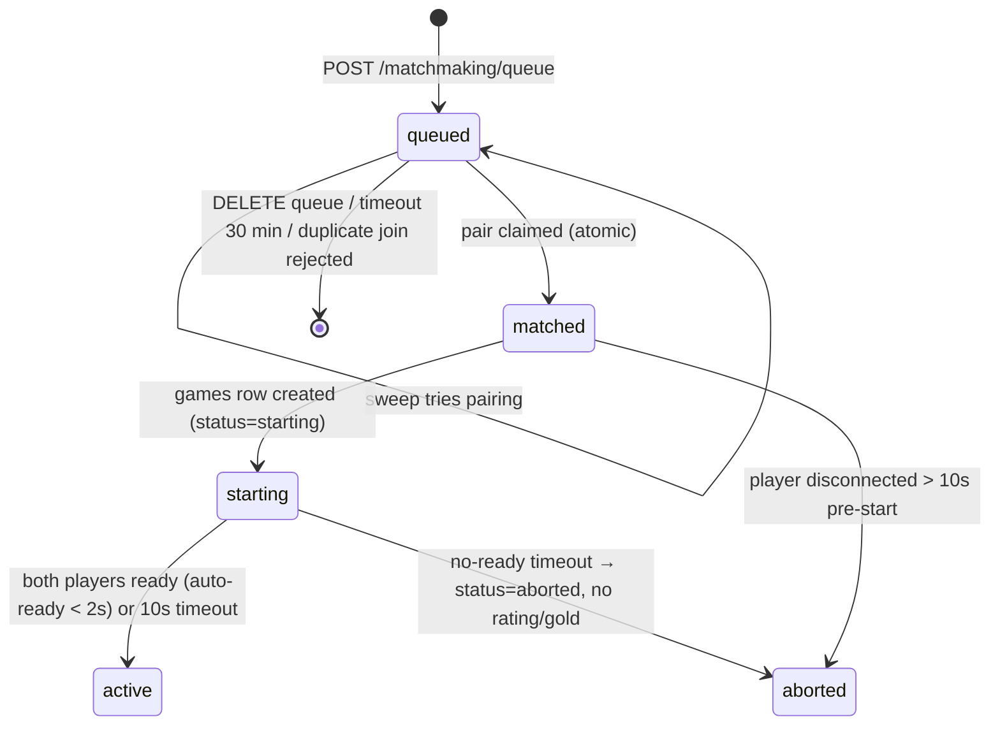
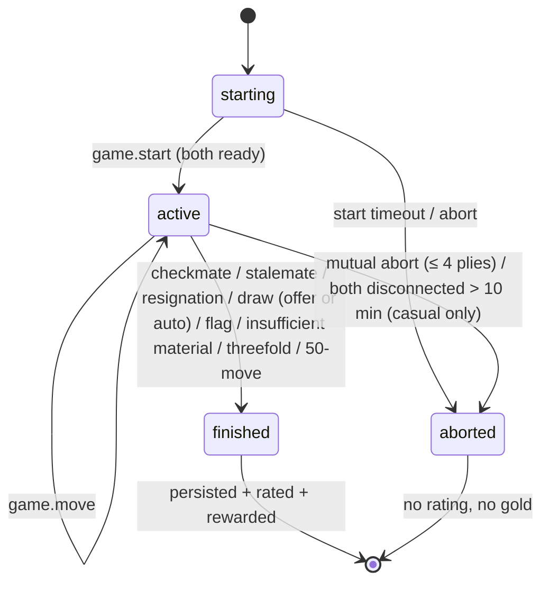

# Game Lifecycle — Chess Hustle

**Status:** Proposed · The normative specification for match/game/rematch state machines, clock semantics, reconnection, and recovery.

---

## 1. Matchmaking lifecycle



**Rules**
- `MM-join`: one active queue entry per user across all pools (join replaces: implicit leave + join).
- Sweep cadence 250 ms; pairing algorithm in `01-architecture/overview.md` §4.2.
- `matched → starting`: both clients auto-join the game channel; server waits ≤ 10 s for both WS `game.ready` (implicit on connect).
- Queue entry TTL 30 min; client is informed via `queue.expired`.

## 2. Game lifecycle



### 2.1 Start
- `game.start` event carries initial FEN, time control, players, colors, `server_ts`, `version=0`. White's clock starts at the event's `server_ts` (not at send).

### 2.2 Moves (normative algorithm)
```
on game.move(game_id, ply, uci, claimed_client_ts?):
  lock(game)                          # in-process mutex + PG row lock cross-node
  assert status == active
  assert ply == moves_count + 1       # server ply numbering; client ply is advisory
  assert sender == player(to_move)
  assert rate_ok (≥ 40 ms since last accepted move by this player)
  pos = position(fen, move_history)
  mv  = parse_and_validate(uci, legal_moves(pos))    # reject if illegal/ambiguous
  now = server_now()
  mover_ms = remaining(mover) - (now - last_tick_ts)
  assert mover_ms > 0                      # flagging handled by sweeper, not by a race here
  mover_ms += increment                    # applied on completed move
  result = evaluate(pos.apply(mv))         # mate / stalemate / insufficient / 50-move (100 halfmoves) / threefold
  version += 1
  TXN(pg): update games(fen, clocks, version, status?, result?); insert moves(ply, uci, san, fen_after, w_ms, b_ms, ts)
  xadd(g:{id}, game.move{ply, san, uci, fen, w_ms, b_ms, version, ts})
  if result: finalize(result)   # §2.4
  auto-decline any outstanding draw offer
```

### 2.3 Termination conditions (all server-detected)
| Condition | Result | Notes |
|---|---|---|
| Checkmate | win (mating side) | |
| Stalemate | draw | |
| Resignation | win (opponent) | REST/WS action, instant, irrevocable |
| Timeout (flag) | win (opponent) **or draw** if opponent has insufficient mating material | §4 |
| Threefold repetition | draw | auto-claimed (platform-standard; FIDE 5-fold auto rule is the strict superset) |
| Fifty-move rule | draw | auto at 100 halfmove-clock |
| Insufficient material | draw | standard dead-position set |
| Mutual abort (≤ 4 plies) | aborted | no rating/gold |
| Abandonment (both disconnected > 10 min, casual only) | aborted | rated games always resolve by clock |

### 2.4 Finalization (single DB transaction)
1. `games.status=finished`, `result`, `termination_reason`, `ended_at`, final FEN.
2. If rated and plies ≥ 4: apply Glicko-2 per pool; write `rating_history` + update `ratings`.
3. Gold gameplay grant (win/draw/loss, daily-capped) via `GoldLedger` (idem key `game:{id}:gold`).
4. Mission/achievement progress updates; completed missions become claimable (not auto-granted — deliberate friction vs dark patterns).
5. Publish `game.result` (rating deltas, new ratings, gold earned, result reason).

**Non-pairing outcomes:** `aborted` games never touch ratings or Gold.

## 3. Clock model (normative)

- Time control = `{initial_ms, increment_ms}` per side. Pool mapping: bullet < 180 s · blitz 180–599 s · rapid 600–1799 s · classical ≥ 1800 s (initial only; increments don't shift pools).
- `last_tick_ts` = server timestamp of the last accepted mutation (or `game.start`).
- On move: mover loses `(now − last_tick_ts)`, then gains `increment`. Opponent's remaining is untouched until they move.
- `deadline = last_tick_ts + remaining(to_move)` → pushed to Redis ZSET `clocks:active` (score = deadline). The clock sweeper (worker, 250 ms; plus server-local sweep as backup) pops due entries → processes flag under game lock with a re-check (`remaining(now) ≤ 0`).
- **Timeout resolution:** if `remaining ≤ 0`: to_move loses, unless the opponent has **insufficient mating material** → draw. Mating-material check (documented approximation, property-tested): opponent can mate iff they have a pawn/rook/queen, ≥ 2 minor pieces, or exactly one minor **plus** the flagged side has any non-king piece (helpmate possibility). Excess-clock rounding: flags fire at `deadline`, no client-side rounding is honored.
- **Lag compensation (flagged experiment, default OFF):** if enabled, `credit = clamp(now − claimed_client_ts − rtt_est/2, 0, 250ms)` per move, cumulative cap 1,500 ms/game; every credit is ledger-logged in `games.meta` and anomaly-flagged if a player's credit ratio exceeds 2× the game median (farm-detection hook). Default OFF because it is client-timestamp-trusting.

## 4. Disconnect, reconnect, resume (normative)

```mermaid
sequenceDiagram
    participant P as Player (WS)
    participant S as Server
    participant O as Opponent
    P->>S: (network drop — clock keeps running)
    S-->>O: game.opponent_left {grace_until}
    Note over S: sweeper continues; opponent cannot claim early; clock decides
    P->>S: reconnect wss://…?ticket
    P->>S: resume {last_ids: {u, g}}
    S->>S: replay XRANGE after last_ids (u + g streams)
    P->>S: GET /games/{id} (snapshot: fen, clocks-from-server-truth, moves, stream_id)
    S-->>P: snapshot + replay (consistent: taken under game lock)
    S-->>O: game.opponent_reconnected
```

**Rules**
- Clocks never pause for disconnection (rated integrity). `grace_until` is informational: opponent actions (e.g., draw offer) are queued but not granted special timeout powers.
- **Snapshot consistency invariant:** `GET /games/{id}` is served under the game lock and returns the `stream_id` of the last event included, so a client applying replay-after-id + snapshot can never double-apply or skip (client-side invariant: discard replayed events with `ply ≤ snapshot.ply` for `game.move`, apply everything else idempotently).
- Multi-device: a second device joining a game channel receives the same snapshot; moves from any session of the correct player are accepted (server validates identity, not device).
- Server restart: resume works because streams live in Redis and snapshots in PG (§7 recovery).
- If both players are disconnected and the flagged side never returns, the clock resolves the game normally; `game.result` is retained in the stream and PG.

## 5. Rematch & challenge flows

- **Rematch:** `POST /games/{id}/rematch` → `rematch.offered` to opponent → accept creates a new game (colors swapped, same TC, same rated flag) → both auto-join. Offer expires in 60 s or on a new rated game start by either side.
- **Friend challenge:** `POST /challenge {handle, tc, rated=false|rated allowed}` → `game.invite` on target's `u` stream → accept creates game with custom TC (BYO-TC allowed among friends; pool games use presets). Invite expires in 120 s.

## 6. Ordering & consistency invariants (testable)

1. **I-1 Total order:** all events on `g:{id}` carry a Redis-stream ID; `version` increments on every accepted mutation; clients apply strictly in stream order.
2. **I-2 No phantom moves:** a move is visible to both players only after its PG commit (the XADD happens inside the same critical section after commit; crash between commit and XADD is healed by snapshot/replay since the stream is rebuilt from `moves` if missing).
3. **I-3 Clock truth:** any client clock is a rendering of `(server_ts, remaining)`; server values are the only ones that terminate games.
4. **I-4 Idempotent actions:** resign/draw/abort/rematch are idempotent per `game_id` (repeated calls return the same outcome, no duplicate events).
5. **I-5 Single terminal transition:** `finished`/`aborted` is write-once; a DB CHECK/trigger rejects a second finalization (protects against sweeper/handler races).

## 7. Persistence & recovery

| Layer | Contents | Loss tolerance | Rebuild |
|---|---|---|---|
| PostgreSQL | games, moves, results, ratings, ledger, users | none (sync commit) | source of truth |
| Redis `g:{id}` hash | current position summary, clocks, version, player map | full | from `moves` (last FEN + elapsed-time computation) |
| Redis `g:{id}:events` stream | event log (fanout + resume), TTL finish+24 h | replayable for live clients | not rebuilt for history (PG covers); live clients get snapshot |
| Redis queues/tickets/presence | ephemeral | full | clients re-join/re-auth; no game impact |

**Rebuild job** (`hustle-worker`, on boot + hourly reconcile): for every `games.status IN (starting, active)` row missing its Redis hash → replay `moves` table rows in ply order → reconstruct FEN (recompute via `hustle-chess` replay; per-ply stored FEN is a cross-check), recompute clocks as `remaining_at_last_move − (now − last_move_ts)`, repopulate hash + publish `game.resync` to the channel.

**Crash-consistency detail (I-2 healing):** if a pod dies between PG commit and XADD, the stream lacks the event but PG has the move; clients hold an older snapshot; on resume they get snapshot ≥ their state and continue correctly. No double-apply is possible because `ply` uniqueness is a DB constraint.

## 8. Tournament integration (phase 3)

Tournament rounds inject pairings into the same game pipeline (`TournamentService` calls `GameService::create_from_pair` with `tournament_id` set); lifecycle rules are identical, plus: auto-start when both present (30 s grace), forfeit rules (absent after round start + 2 min = forfeit loss, simplified FIDE), pairings published via `t:{id}` channel. Full spec ships with the phase-3 design note; the state machine and invariants above are normative for tournament games too.
