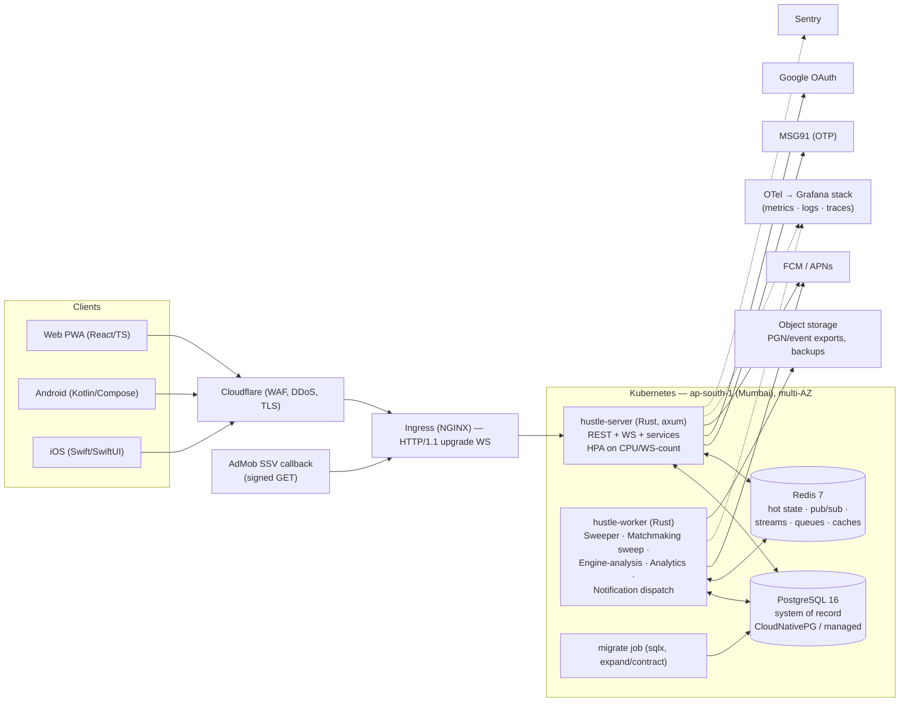

# Architecture Overview — Chess Hustle

**Status:** Proposed · Related: ADR-001 (modular monolith), ADR-002 (PG+Redis), ADR-004 (WS protocol), ADR-012 (repo layout)

---

## 1. Architectural principles

1. **Server-authoritative everything.** Clients render; the server decides. Legality, clocks, results, ratings, Gold, quotas — all computed and enforced server-side.
2. **Modular monolith first.** One deployable Rust binary; domain crates with hard boundaries. Extract a service only when a measured, specific limit is hit (ADR-001).
3. **Crash-consistent by design.** Postgres is the system of record; Redis holds hot state that is *always rebuildable* from PG (ADR-002).
4. **Config, not code.** Every tunable rate/quota/window lives in `app_config` with admin API + audit log.
5. **Determinism for tests.** Chess rules, ratings, and economy are pure functions over explicit inputs; IO lives at the edges.
6. **Privacy by architecture.** Minimal PII (phone/email only), no third-party trackers, India-region hosting.

## 2. System topology



**Single binary, two processes.** `hustle-server` (REST + WS + all domain services) and `hustle-worker` (periodic and batch jobs) build from the same workspace, share domain crates, and deploy separately for independent scaling. At launch both can run small; the split exists so a heavy analytics batch can never starve the move path.

## 3. Domain boundaries (ADR-001)

Each domain is a workspace crate that **owns its tables exclusively** — no cross-domain SQL. Cross-domain calls go through in-process traits (ports), so a future extraction is a swap of the adapter, not a rewrite.

| Crate | Owns (tables) | Exposes (ports) |
|---|---|---|
| `hustle-kernel` | — | config, error types, telemetry, clock, ids, feature flags reader |
| `hustle-domain` | — | pure types: chess rules, Glicko-2, Gold math, pairings math (no IO) |
| `hustle-chess` | `games`, `moves` | `GameService` (create, move, resign/draw/abort, finish, snapshot, replay) |
| `hustle-identity` | `users`, `auth_identities`, `user_sessions`, `consent_records` | `AuthService`, `SessionStore` |
| `hustle-profiles` | `profiles`, `user_settings`, `blocks` | `ProfileReader`, `BlockChecker` |
| `hustle-matchmaking` | Redis queue state (no PG tables) | `QueueService` (join/leave/sweep) → calls `GameService::create_from_pair` |
| `hustle-ratings` | `ratings`, `rating_history` | `RatingReader`, `RatingApplier` |
| `hustle-gold` | `gold_balances`, `gold_ledger` | `GoldLedger` (grant/spend, idempotent) |
| `hustle-rewards` | `daily_claims`, `user_missions`, `user_achievements`, `mission_defs` | `RewardService` |
| `hustle-ads` | `ad_sessions`, `ad_reward_events`, `ad_quota_daily` | `AdService`, port `AdVerifier` |
| `hustle-cosmetics` | `cosmetics`, `user_cosmetics`, `user_loadout` | `CatalogReader`, `StoreService` |
| `hustle-tournaments` | `tournaments`, `tournament_entries`, `tournament_pairings` | `TournamentService` (uses `GameService`, `GoldLedger`) |
| `hustle-friends` | `friendships` | `FriendService` |
| `hustle-realtime` | Redis streams (no PG) | `EventPublisher`, `WsSessions`, `TicketStore` |
| `hustle-notifications` | `notifications`, `device_tokens` | `NotificationService` |
| `hustle-moderation` | `chat_messages`, `reports`, `sanctions`, `anomaly_flags` | `ModerationService` |
| `hustle-analytics` | `app_events` | `EventSink` |
| `hustle-admin` | `app_config`, `admin_audit_log`, `feature_flags` | admin API + config cache |
| `hustle-api` | — | axum routers: REST v1 + WS + admin; DTO/validation layer |
| `hustle-server` / `hustle-worker` | — | binaries (composition roots) |

**Boundary rules (enforced by review + `cargo` visibility):**
- A crate may not name another domain's tables. It receives data via trait arguments.
- Shared row types that cross domains are duplicated at the port level (narrow DTOs), not shared structs — prevents hidden coupling.
- All money-like math (Gold) lives in `hustle-domain::economy` as pure functions with unit tests; DB layer only applies results.

## 4. Runtime data flows

### 4.1 Move path (hot path — the latency-critical one)

```mermaid
sequenceDiagram
    participant C as Client (WS)
    participant API as hustle-server
    participant L as Per-game lock (tokio)
    participant CH as hustle-chess (shakmaty)
    participant PG as PostgreSQL
    participant RD as Redis
    participant O as Opponent (WS)

    C->>API: ws {type:"game.move", data:{game_id, ply, uci, client_ts?}}
    API->>API: authn (WS session) → player == game.to_move?
    API->>L: acquire game lock (in-process; cross-node via advisory row lock fallback)
    API->>CH: apply(uci) → legal? result? clocks
    CH-->>API: {fen_after, san, result?, w_ms, b_ms, version++}
    API->>PG: TXN: UPDATE games SET fen=…, version=…; INSERT moves(...)
    API->>RD: XADD g:{id} game.move{...}; PUBLISH ws:g:{id}
    API-->>C: ack (event echo)
    RD-->>O: deliver event (both sockets fanout)
    alt result decided (mate/flag/draw)
        API->>PG: TXN: finalize (ratings, gold, missions, achievements)
        API->>RD: XADD game.result
    end
```

Persistence happens **inline in the move transaction** (single-digit-ms on local PG at v1 scale) — not deferred — so any crash loses at most the in-flight move, which clients recover via resume+snapshot. Scale escape hatch (deferred write-behind with Redis as WAL) is specified in `02-data/schema.md` §7 and activated only past measured thresholds.

### 4.2 Matchmaking path

Sweeper (worker, leader-elected via Redis lock) every 250 ms per pool:

```
1. FIFO iterate queue ZSET (score = enqueue_ts)
2. For oldest waiting player p:
     window(p) = min(75 + 15 * (now - enqueue_s), 700)   # provisional: 400 flat
     find first other player q with |rating(p)-rating(q)| <= min(window(p), window(q))
       and not blocked(pair) and not recent_rem(pair)
3. Atomic claim: pipeline ZREM queue p,q + HSET claimed {game_seed}
   (Lua script = single atomic step; on partial failure, re-add loser)
4. Colors: balance last-10 color counts; RNG seeded from pair+ts
5. GameService::create_from_pair (PG insert games row, status=starting)
6. Publish matchmaking.matched on both u-channels; both clients GET snapshot and join
```

Casual pool: rating window fixed ±1000. Provisional: paired with provisional first (same sweep, second pass). Queue state is Redis-only; a Redis loss costs in-flight queues (rejoin is automatic and acceptable) — games are never queue-dependent.

### 4.3 Ad-reward path (trust boundary)

Client can only *request* an ad session and *display* the ad. Gold is granted exclusively inside the server-verified SSV callback handler (`04-economy/rewarded-ads.md`): verify signature → dedupe `transaction_id` → re-check quota/cooldown/eligibility under row lock → ledger grant → mark session completed → publish `economy.update`. Two workstreams (callback arrives out-of-band) meet at one idempotency key: `ads:{provider}:{transaction_id}`.

### 4.4 Config & flags

`app_config` (PG) → Redis cache (60 s TTL) → in-memory snapshot refreshed on change (admin write publishes invalidation). Config writes are admin-authenticated and audit-logged (`admin_audit_log`). Feature flags (`feature_flags`) gate experiments (ads rollout %, lag-comp experiment, bots).

## 5. Deployment topology & runtime model

| Concern | Choice | Notes |
|---|---|---|
| Runtime | Rust 1.8x stable, axum 0.8, tokio, sqlx (PG), redis-rs, tracing+OTel | single event-loop per process; no blocking IO on hot path |
| HTTP+WS | Same process/port; NGINX ingress upgrades WS | sticky not required (any node serves any socket; game locks coordinate via PG advisory locks cross-node) |
| Scale unit | `hustle-server` replica count | HPA on CPU + WS connection count; 2× AZ spread |
| Workers | `hustle-worker` with 1–N replicas | leader-elected loops (Redis lock): mm-sweep, clock-sweep, analytics, push-dispatch; fan-out loops (analysis) |
| Stateful | PG (CloudNativePG or managed), Redis (managed or in-cluster with AOF) | ADR-013 |
| Admin | Same API, `admin` role guard + separate OIDC for dashboard, IP-allowlisted | split into its own service at >50 staff (not before) |
| Migrations | sqlx migrations as a pre-deploy Job; expand→contract two-phase for breaking changes | no downtime deployments |

**Cross-node game coordination:** in-process per-game `tokio::sync::Mutex` keyed by `game_id`; if the game's next move arrives at a different server replica, correctness is preserved by `SELECT … FOR UPDATE` on the `games` row inside the move transaction (the row is the cross-node lock; version column detects any drift). In practice, WS affinity makes same-node the norm (both players' sockets usually land on one replica at v1 scale; if they split, the row lock path costs ~2 extra ms).

## 6. Failure & recovery model (summary; details in `01-architecture/game-lifecycle.md` §7)

- **Pod crash mid-game:** PG holds every accepted ply; Redis streams hold every event. On restart, games' authoritative state = last PG row; Redis rebuilt from `moves` for any game missing its Redis hash. Clients resume via snapshot+`last_ids`.
- **Redis loss:** games rebuild from PG (fen of last move + clock elapsed since last move's server timestamp); queues/streams/tickets are ephemeral by design. Documented rebuild job + runbook.
- **PG failover:** sync-replica within AZ; app circuit-breaks reads for ≤ 30 s then reconnects; games in progress continue from Redis, which then flushes on reconnect (PG-first invariant keeps this safe because every accepted move was already committed before the failover could complete).

## 7. What is explicitly NOT in the architecture (and why)

- **No microservices / message bus / Kafka / ClickHouse at v1.** Event volume (≤ a few hundred/s) is trivially served by PG + Redis Streams. The `EventSink` port means adding a bus later touches one adapter.
- **No Kubernetes operators beyond what's needed.** We use manifests (Kustomize) over Helm charts for a small, auditable surface.
- **No client-side chess engine** for hints (server analysis is Phase 4+; avoids a whole class of "engine help" ambiguity in rated play).
- **No WebSocket gateway as a separate service yet.** At 10k concurrent WS a single axum process handles it with headroom; the split is documented as the first extraction candidate (ADR-001) with its trigger metric.
