# Data Schema — Chess Hustle

**Status:** Proposed · **Engine:** PostgreSQL 16 · **Migrations:** sqlx, pre-deploy job, expand→contract for breaking changes (ADR-012)

---

## 1. Conventions

| Convention | Rule |
|---|---|
| Primary keys | `bigint GENERATED ALWAYS AS IDENTITY` internally |
| Public IDs | ULID `text` with `UNIQUE` (`public_id`) for externally-addressable rows (games, tournaments, ad sessions) — never expose internal bigint |
| Timestamps | `timestamptz` (UTC); IST-day boundaries computed in app via `Asia/Kolkata` |
| Enum-like columns | `text` + `CHECK (col IN (...))` — easier to evolve than PG enums |
| Money (Gold) | `bigint`; never float |
| Names | snake_case; no `pg_` reserved words; single-word table names owned by one domain crate (ownership table in overview §3) |
| Nullable FKs | Explicit `ON DELETE` per semantics (users are never hard-deleted — anonymized) |
| Updated-at | Set in application code (sqlx) — no trigger magic |

## 2. ER diagram (relational spine)

```mermaid
erDiagram
    users ||--o{ auth_identities : "has"
    users ||--o{ user_sessions : "devices"
    users ||--o{ consent_records : "DPDP consent"
    users ||--|| profiles : "public face"
    users ||--|| user_settings : "prefs"
    users ||--o{ games : "white/black"
    games ||--o{ moves : "plies"
    games ||--o| chat_messages : "in-game chat"
    users ||--o{ ratings : "per pool"
    users ||--o{ rating_history : "every rated game"
    users ||--|| gold_balances : "1:1 cache"
    users ||--o{ gold_ledger : "append-only truth"
    users ||--o{ daily_claims : "streak state"
    mission_defs ||--o{ user_missions : "progress"
    users ||--o{ user_missions : ""
    users ||--o{ user_achievements : ""
    users ||--o{ user_cosmetics : "inventory"
    cosmetics ||--o{ user_cosmetics : ""
    users ||--|| user_loadout : "equipped"
    users ||--o{ ad_sessions : "rewarded attempts"
    ad_sessions |o--o| ad_reward_events : "verified once"
    users ||--o{ ad_quota_daily : "per IST day"
    tournaments ||--o{ tournament_entries : ""
    users ||--o{ tournament_entries : ""
    tournaments ||--o{ tournament_pairings : "rounds"
    users ||--o{ friendships : "requester/addressee"
    users ||--o{ blocks : ""
    users ||--o{ reports : "reporter/target"
    users ||--o{ sanctions : ""
    users ||--o{ anomaly_flags : "subject"
    users ||--o{ notifications : "feed"
    users ||--o{ device_tokens : "push"
    users ||--o{ data_export_jobs : "DPDP export"
```



Standalone: `app_config`, `feature_flags`, `admin_audit_log`, `app_events` (partitioned), `data_export_jobs`.

## 3. DDL — Identity & consent (`hustle-identity`)

```sql
CREATE TABLE users (
  id                   bigint GENERATED ALWAYS AS IDENTITY PRIMARY KEY,
  status               text NOT NULL DEFAULT 'active'
                       CHECK (status IN ('active','deletion_requested','anonymized','suspended')),
  role                 text NOT NULL DEFAULT 'user' CHECK (role IN ('user','moderator','admin')),
  phone_e164           text UNIQUE,              -- filled when phone identity linked
  email                text UNIQUE,
  age_confirmed_at     timestamptz,              -- 18+ gate moment (ADR-010)
  deletion_requested_at timestamptz,
  anonymized_at        timestamptz,
  created_at           timestamptz NOT NULL DEFAULT now(),
  CONSTRAINT users_min_identity CHECK (phone_e164 IS NOT NULL OR email IS NOT NULL)
);
-- users are never DELETEd; anonymization nulls PII and randomizes identifiers (DPDP §erasure)

CREATE TABLE auth_identities (
  id          bigint GENERATED ALWAYS AS IDENTITY PRIMARY KEY,
  user_id     bigint NOT NULL REFERENCES users(id),
  kind        text NOT NULL CHECK (kind IN ('phone','google')),
  identifier  text NOT NULL,                       -- e.164 phone or Google `sub`
  verified_at timestamptz,
  created_at  timestamptz NOT NULL DEFAULT now(),
  UNIQUE (kind, identifier)
);
CREATE INDEX ON auth_identities (user_id);

CREATE TABLE user_sessions (
  id            bigint GENERATED ALWAYS AS IDENTITY PRIMARY KEY,
  user_id       bigint NOT NULL REFERENCES users(id),
  family_id     uuid NOT NULL,                     -- rotation family (reuse detection)
  refresh_hash  text NOT NULL UNIQUE,              -- sha256(refresh_token)
  device_label  text,
  ip_hash       text,                              -- hashed; DPDP minimization
  created_at    timestamptz NOT NULL DEFAULT now(),
  last_used_at  timestamptz NOT NULL DEFAULT now(),
  revoked_at    timestamptz,
  revoked_reason text CHECK (revoked_reason IN ('logout','logout_all','rotation_reuse','admin'))
);
CREATE INDEX ON user_sessions (user_id) WHERE revoked_at IS NULL;

CREATE TABLE consent_records (
  id             bigint GENERATED ALWAYS AS IDENTITY PRIMARY KEY,
  user_id        bigint NOT NULL REFERENCES users(id),
  policy_version text NOT NULL,                    -- tos/privacy doc version
  purpose        text NOT NULL CHECK (purpose IN ('essential','functional','marketing','personalised_ads','chat')),
  granted        boolean NOT NULL,
  ip_hash        text,
  created_at     timestamptz NOT NULL DEFAULT now()
);
CREATE INDEX ON consent_records (user_id, purpose, created_at DESC);

CREATE TABLE device_tokens (
  id        bigint GENERATED ALWAYS AS IDENTITY PRIMARY KEY,
  user_id   bigint NOT NULL REFERENCES users(id),
  platform  text NOT NULL CHECK (platform IN ('android','ios','web')),
  token     text NOT NULL,
  updated_at timestamptz NOT NULL DEFAULT now(),
  UNIQUE (user_id, platform, token)
);
```

## 4. DDL — Profiles & social (`hustle-profiles`, `hustle-friends`)

```sql
CREATE TABLE profiles (
  user_id        bigint PRIMARY KEY REFERENCES users(id),
  handle         citext NOT NULL UNIQUE CHECK (handle ~ '^[a-z0-9_]{3,20}$'),
  display_name   text NOT NULL CHECK (char_length(display_name) BETWEEN 2 AND 30),
  bio            text CHECK (char_length(bio) <= 200),
  country        text NOT NULL DEFAULT 'IN',
  avatar_cosmetic_id text REFERENCES cosmetics(id),     -- nullable until equipped
  games_count    int NOT NULL DEFAULT 0,               -- denormalized counters,
  wins           int NOT NULL DEFAULT 0,               -- maintained in finalize TXN
  losses         int NOT NULL DEFAULT 0,
  draws          int NOT NULL DEFAULT 0,
  created_at     timestamptz NOT NULL DEFAULT now()
);

CREATE TABLE user_settings (
  user_id            bigint PRIMARY KEY REFERENCES users(id),
  chat_enabled       boolean NOT NULL DEFAULT true,
  sound_enabled      boolean NOT NULL DEFAULT true,
  premove_enabled    boolean NOT NULL DEFAULT true,
  quiet_hours_start  int NOT NULL DEFAULT 22,          -- IST hour
  quiet_hours_end    int NOT NULL DEFAULT 7,
  marketing_opt_in   boolean NOT NULL DEFAULT false,   -- also mirrored in consent_records
  updated_at         timestamptz NOT NULL DEFAULT now()
);

CREATE TABLE friendships (
  id              bigint GENERATED ALWAYS AS IDENTITY PRIMARY KEY,
  requester_id    bigint NOT NULL REFERENCES users(id),
  addressee_id    bigint NOT NULL REFERENCES users(id),
  status          text NOT NULL DEFAULT 'pending'
                  CHECK (status IN ('pending','accepted','declined','removed')),
  created_at      timestamptz NOT NULL DEFAULT now(),
  responded_at    timestamptz,
  CONSTRAINT fr_not_self CHECK (requester_id <> addressee_id),
  UNIQUE (requester_id, addressee_id)
);
CREATE INDEX ON friendships (addressee_id) WHERE status = 'pending';
CREATE INDEX ON friendships (requester_id) WHERE status = 'pending';

CREATE TABLE blocks (
  blocker_id  bigint NOT NULL REFERENCES users(id),
  blocked_id  bigint NOT NULL REFERENCES users(id),
  created_at  timestamptz NOT NULL DEFAULT now(),
  PRIMARY KEY (blocker_id, blocked_id),
  CONSTRAINT b_not_self CHECK (blocker_id <> blocked_id)
);
```

## 5. DDL — Chess core (`hustle-chess`)

```sql
CREATE TABLE games (
  id             bigint GENERATED ALWAYS AS IDENTITY PRIMARY KEY,
  public_id      text NOT NULL UNIQUE,               -- ULID
  white_user_id  bigint NOT NULL REFERENCES users(id),
  black_user_id  bigint NOT NULL REFERENCES users(id),
  pool           text NOT NULL CHECK (pool IN ('bullet','blitz','rapid','classical')),
  time_control   jsonb NOT NULL,                     -- {"initial_ms":180000,"increment_ms":2000}
  rated          boolean NOT NULL,
  status         text NOT NULL DEFAULT 'starting'
                 CHECK (status IN ('starting','active','finished','aborted')),
  result         text CHECK (result IN ('white','black','draw')),   -- NULL unless finished
  termination    text CHECK (termination IN ('checkmate','stalemate','resignation',
                    'timeout','insufficient_material','agreement','threefold',
                    'fifty_move','aborted','abandoned','forfeit')),
  fen_start      text NOT NULL,
  fen_current    text NOT NULL,
  move_count     int NOT NULL DEFAULT 0,             -- plies played
  w_remaining_ms bigint,
  b_remaining_ms bigint,
  last_tick_ts   timestamptz,                        -- server ts of last mutation
  version        int NOT NULL DEFAULT 0,             -- monotonic per game (I-1)
  tournament_id  bigint REFERENCES tournaments(id),  -- null for pool games
  rematch_of     bigint REFERENCES games(id),
  created_at     timestamptz NOT NULL DEFAULT now(),
  started_at     timestamptz,
  ended_at       timestamptz,
  meta           jsonb NOT NULL DEFAULT '{}',        -- lag credits, flags, notes
  -- write-once terminal state (I-5): a second finalization is rejected by DB
  CONSTRAINT games_result_iff_finished CHECK (
    (status = 'finished' AND result IS NOT NULL AND termination IS NOT NULL)
    OR (status IN ('starting','active') AND result IS NULL)
    OR (status = 'aborted' AND result IS NULL)
  ),
  CONSTRAINT games_not_self CHECK (white_user_id <> black_user_id)
);
CREATE INDEX ON games (white_user_id, created_at DESC);
CREATE INDEX ON games (black_user_id, created_at DESC);
CREATE INDEX ON games (status) WHERE status IN ('starting','active');  -- sweeper/rebuild
CREATE INDEX ON games (tournament_id) WHERE tournament_id IS NOT NULL;
CREATE INDEX ON games (created_at DESC);                               -- recent-games feeds

CREATE TABLE moves (
  id          bigint GENERATED ALWAYS AS IDENTITY,
  game_id     bigint NOT NULL REFERENCES games(id),
  ply         int  NOT NULL,                         -- 1-based, server-numbered
  uci         text NOT NULL,
  san         text NOT NULL,
  fen_after   text NOT NULL,
  w_remaining_ms bigint NOT NULL,
  b_remaining_ms bigint NOT NULL,
  ts          timestamptz NOT NULL,
  meta        jsonb NOT NULL DEFAULT '{}',
  PRIMARY KEY (game_id, ply),                        -- I-2: no duplicate plies, replay order
  CONSTRAINT mv_gt_zero CHECK (ply >= 1)
) ;
CREATE INDEX ON moves (ts);                          -- analytics/export scans
```

> `moves` uses a composite PK (no surrogate id) — it is addressed only within a game; replay order is the PK order.

## 6. DDL — Ratings (`hustle-ratings`)

```sql
CREATE TABLE ratings (
  user_id      bigint NOT NULL REFERENCES users(id),
  pool         text NOT NULL CHECK (pool IN ('bullet','blitz','rapid','classical')),
  rating       real NOT NULL DEFAULT 1200,
  rd           real NOT NULL DEFAULT 350,            -- Glicko-2 deviation
  volatility   real NOT NULL DEFAULT 0.06,
  games_count  int  NOT NULL DEFAULT 0,
  peak         real NOT NULL DEFAULT 1200,
  last_game_at timestamptz,
  PRIMARY KEY (user_id, pool),
  CONSTRAINT rd_bounds CHECK (rd >= 30 AND rd <= 350)
);
CREATE INDEX ON ratings (pool, rating DESC);         -- leaderboards / pairing scans

CREATE TABLE rating_history (
  id            bigint GENERATED ALWAYS AS IDENTITY PRIMARY KEY,
  user_id       bigint NOT NULL REFERENCES users(id),
  pool          text NOT NULL,
  game_id       bigint NOT NULL REFERENCES games(id),
  rating_before real NOT NULL,
  rating_after  real NOT NULL,
  rd_after      real NOT NULL,
  delta         real NOT NULL,
  created_at    timestamptz NOT NULL DEFAULT now()
);
CREATE INDEX ON rating_history (user_id, pool, created_at DESC);
```

## 7. DDL — Gold economy (`hustle-gold`) — normative ledger semantics

```sql
CREATE TABLE gold_balances (
  user_id    bigint PRIMARY KEY REFERENCES users(id),
  balance    bigint NOT NULL CHECK (balance >= 0),   -- DB-enforced non-negativity
  updated_at timestamptz NOT NULL DEFAULT now()
);

CREATE TABLE gold_ledger (
  id            bigint GENERATED ALWAYS AS IDENTITY PRIMARY KEY,
  user_id       bigint NOT NULL REFERENCES users(id),
  delta         bigint NOT NULL CHECK (delta <> 0),
  balance_after bigint NOT NULL,                     -- audit snapshot at write time
  reason        text NOT NULL CHECK (reason IN (
                  'welcome','daily_streak','mission','achievement','gameplay',
                  'ad_reward','cosmetic_purchase','support_grant','adjustment')),
  ref_type      text,                                -- 'game','ad_session','mission',…
  ref_id        text,
  idem_key      text UNIQUE,                         -- NULL for admin ops (audited separately)
  meta          jsonb NOT NULL DEFAULT '{}',
  created_at    timestamptz NOT NULL DEFAULT now(),
  CONSTRAINT gl_delta_sign CHECK (
    (delta > 0 AND reason IN ('welcome','daily_streak','mission','achievement',
                              'gameplay','ad_reward','support_grant','adjustment'))
    OR (delta < 0 AND reason IN ('cosmetic_purchase','adjustment'))
  )
);
CREATE INDEX ON gold_ledger (user_id, created_at DESC);
CREATE INDEX ON gold_ledger (reason, created_at);    -- economy source/sink analytics
-- monthly partitions on (created_at) after launch month 1 (§8)
```

**Ledger write pattern (every Gold mutation):**

```sql
BEGIN;
  SELECT balance FROM gold_balances WHERE user_id = $1 FOR UPDATE;   -- serialize per user
  INSERT INTO gold_ledger (user_id, delta, balance_after, reason, ref_type, ref_id, idem_key, meta)
    VALUES ($1, $2, $3, $4, $5, $6, $7, $8) ON CONFLICT (idem_key) DO NOTHING
    RETURNING (CASE WHEN xmax = 0 THEN true ELSE false END) AS inserted;  -- retry-safe
  IF inserted:
    UPDATE gold_balances SET balance = balance + $2, updated_at = now() WHERE user_id = $1;
    -- CHECK(balance >= 0) aborts TXN on any negative outcome — structurally impossible to overdraw
  COMMIT;
```

## 8. DDL — Rewards (`hustle-rewards`)

```sql
CREATE TABLE daily_claims (
  user_id   bigint NOT NULL REFERENCES users(id),
  ist_date  date  NOT NULL,
  streak    int   NOT NULL,                        -- streak position after this claim (1..7)
  claimed_at timestamptz NOT NULL DEFAULT now(),
  PRIMARY KEY (user_id, ist_date)                  -- one claim per IST day, idempotent by PK
);

CREATE TABLE mission_defs (
  id          text PRIMARY KEY,                    -- 'daily_win_1', 'weekly_play_15'
  kind        text NOT NULL CHECK (kind IN ('daily','weekly')),
  title_key   text NOT NULL,                       -- i18n key
  goal_type   text NOT NULL CHECK (goal_type IN ('games_played','wins','draws','checkmates',
                       'ads_completed','tournaments_played','minutes_played')),
  goal_params jsonb NOT NULL DEFAULT '{}',         -- {"count":3,"pool":"blitz"}
  reward_gold bigint NOT NULL CHECK (reward_gold > 0),
  active      boolean NOT NULL DEFAULT true
);

CREATE TABLE user_missions (
  user_id     bigint NOT NULL REFERENCES users(id),
  mission_id  text   NOT NULL REFERENCES mission_defs(id),
  period_key  text   NOT NULL,                     -- '2026-11-17' (daily) | '2026-W47' (weekly, ISO)
  progress    int    NOT NULL DEFAULT 0,
  goal        int    NOT NULL,
  claimed     boolean NOT NULL DEFAULT false,
  claimed_at  timestamptz,
  PRIMARY KEY (user_id, mission_id, period_key)
);

CREATE TABLE achievement_defs (
  id          text PRIMARY KEY,                    -- stable ids: 'first_win', 'streak_7'
  title_key   text NOT NULL,                       -- i18n key
  goal_type   text NOT NULL CHECK (goal_type IN ('games_played','wins','checkmates',
                       'streak_days','rating_peak','tournaments_played','tournament_podium')),
  goal_params jsonb NOT NULL DEFAULT '{}',         -- {"count":100} | {"pool":"blitz","peak":1800}
  reward_gold bigint NOT NULL CHECK (reward_gold > 0),
  active      boolean NOT NULL DEFAULT true
);

CREATE TABLE user_achievements (
  user_id         bigint NOT NULL REFERENCES users(id),
  achievement_id  text   NOT NULL REFERENCES achievement_defs(id),
  granted_at      timestamptz NOT NULL DEFAULT now(),
  PRIMARY KEY (user_id, achievement_id)            -- one-time grants, idempotent by PK
);
```

## 9. DDL — Ads (`hustle-ads`)

```sql
CREATE TABLE ad_sessions (
  id          bigint GENERATED ALWAYS AS IDENTITY PRIMARY KEY,
  public_id   text NOT NULL UNIQUE,                -- passed as SSV custom data / user_id context
  user_id     bigint NOT NULL REFERENCES users(id),
  provider    text NOT NULL CHECK (provider IN ('admob')),   -- extended per provider port
  status      text NOT NULL DEFAULT 'pending'
              CHECK (status IN ('pending','completed','expired','rejected')),
  created_at  timestamptz NOT NULL DEFAULT now(),
  expires_at  timestamptz NOT NULL,                -- created + 30 min
  completed_at timestamptz
);
CREATE INDEX ON ad_sessions (user_id, created_at DESC);

CREATE TABLE ad_reward_events (
  id             bigint GENERATED ALWAYS AS IDENTITY PRIMARY KEY,
  provider       text NOT NULL,
  transaction_id text NOT NULL,                    -- provider txn id (dedupe/replay anchor)
  user_id        bigint NOT NULL REFERENCES users(id),
  session_id     bigint NOT NULL REFERENCES ad_sessions(id),
  gold_amount    bigint NOT NULL,
  verified_at    timestamptz NOT NULL DEFAULT now(),
  meta           jsonb NOT NULL DEFAULT '{}',      -- raw signed params hash for forensics
  UNIQUE (provider, transaction_id)               -- replay protection (ADR-007)
);

CREATE TABLE ad_quota_daily (
  user_id  bigint NOT NULL REFERENCES users(id),
  ist_date date   NOT NULL,
  used     int    NOT NULL DEFAULT 0 CHECK (used >= 0),
  PRIMARY KEY (user_id, ist_date)
);
```

## 10. DDL — Cosmetics (`hustle-cosmetics`)

```sql
CREATE TABLE cosmetics (
  id           text PRIMARY KEY,                   -- 'board_chaturanga', 'pieces_neon'
  category     text NOT NULL CHECK (category IN ('board','pieces','avatar','frame')),
  name_key     text NOT NULL,
  price_gold   bigint NOT NULL CHECK (price_gold > 0),
  rarity       text NOT NULL CHECK (rarity IN ('common','rare','epic','legendary')),
  preview      jsonb NOT NULL,                     -- asset refs (CDN keys)
  available_from timestamptz,
  available_to   timestamptz,                      -- seasonal windows; no gacha ever
  active       boolean NOT NULL DEFAULT true
);
CREATE INDEX ON cosmetics (category, price_gold) WHERE active;

CREATE TABLE user_cosmetics (
  user_id      bigint NOT NULL REFERENCES users(id),
  cosmetic_id  text   NOT NULL REFERENCES cosmetics(id),
  acquired_at  timestamptz NOT NULL DEFAULT now(),
  PRIMARY KEY (user_id, cosmetic_id)
);

CREATE TABLE user_loadout (
  user_id    bigint PRIMARY KEY REFERENCES users(id),
  board_id   text REFERENCES cosmetics(id),
  pieces_id  text REFERENCES cosmetics(id),
  avatar_id  text REFERENCES cosmetics(id),
  frame_id   text REFERENCES cosmetics(id)
);  -- ownership validated in service (owned cosmetics only)
```

## 11. DDL — Tournaments (`hustle-tournaments`)

```sql
CREATE TABLE tournaments (
  id          bigint GENERATED ALWAYS AS IDENTITY PRIMARY KEY,
  public_id   text NOT NULL UNIQUE,
  name        text NOT NULL,
  tc          jsonb NOT NULL,                      -- one time control for all rounds
  rounds      int NOT NULL CHECK (rounds BETWEEN 3 AND 11),
  round_minutes int NOT NULL,
  status      text NOT NULL DEFAULT 'scheduled'
              CHECK (status IN ('scheduled','registering','running','finished','cancelled')),
  starts_at   timestamptz NOT NULL,
  registration_closes_at timestamptz NOT NULL,
  capacity    int NOT NULL CHECK (capacity <= 512),
  prize_config jsonb NOT NULL,                     -- {"splits":[{rank:1,gold:5000},…]} issuance-only
  created_by  bigint NOT NULL REFERENCES users(id),
  meta        jsonb NOT NULL DEFAULT '{}',
  CONSTRAINT tn_no_fees CHECK (meta->>'entry_fee_gold' IS NULL)  -- ADR-011 guard
);

CREATE TABLE tournament_entries (
  tournament_id bigint NOT NULL REFERENCES tournaments(id),
  user_id       bigint NOT NULL REFERENCES users(id),
  joined_at     timestamptz NOT NULL DEFAULT now(),
  withdrawn     boolean NOT NULL DEFAULT false,
  final_rank    int,
  prize_gold    bigint,
  PRIMARY KEY (tournament_id, user_id)
);

CREATE TABLE tournament_pairings (
  id            bigint GENERATED ALWAYS AS IDENTITY PRIMARY KEY,
  tournament_id bigint NOT NULL REFERENCES tournaments(id),
  round         int NOT NULL,
  board         int NOT NULL,
  white_id      bigint REFERENCES users(id),       -- NULL = bye pairing
  black_id      bigint REFERENCES users(id),
  game_id       bigint REFERENCES games(id),
  result        text CHECK (result IN ('white','black','draw','bye','forfeit_white','forfeit_black')),
  UNIQUE (tournament_id, round, board)
);
CREATE INDEX ON tournament_pairings (game_id) WHERE game_id IS NOT NULL;
```

## 12. DDL — Chat, moderation, trust (`hustle-moderation`)

```sql
CREATE TABLE chat_messages (
  id         bigint GENERATED ALWAYS AS IDENTITY PRIMARY KEY,
  game_id    bigint NOT NULL REFERENCES games(id),
  user_id    bigint NOT NULL REFERENCES users(id),
  body       text NOT NULL CHECK (char_length(body) <= 200),
  masked     boolean NOT NULL DEFAULT false,        -- profanity mask applied
  redacted   boolean NOT NULL DEFAULT false,        -- moderation takedown (IT Rules)
  created_at timestamptz NOT NULL DEFAULT now()
);
CREATE INDEX ON chat_messages (game_id, created_at);
-- 90-day retention job deletes older rows (compliance §5)

CREATE TABLE reports (
  id              bigint GENERATED ALWAYS AS IDENTITY PRIMARY KEY,
  reporter_id     bigint NOT NULL REFERENCES users(id),
  category        text NOT NULL CHECK (category IN ('cheating','abuse','inappropriate_name','other')),
  target_user_id  bigint NOT NULL REFERENCES users(id),
  game_id         bigint REFERENCES games(id),
  note            text CHECK (char_length(note) <= 500),
  status          text NOT NULL DEFAULT 'open'
                  CHECK (status IN ('open','reviewing','actioned','dismissed')),
  resolution      jsonb,
  created_at      timestamptz NOT NULL DEFAULT now(),
  resolved_at     timestamptz
);
CREATE INDEX ON reports (status, created_at) WHERE status IN ('open','reviewing');

CREATE TABLE sanctions (
  id         bigint GENERATED ALWAYS AS IDENTITY PRIMARY KEY,
  user_id    bigint NOT NULL REFERENCES users(id),
  kind       text NOT NULL CHECK (kind IN ('warning','mute','mm_suspension','ad_suspension','suspension')),
  reason     text NOT NULL,
  issued_by  text NOT NULL,                        -- moderator id / system
  evidence   jsonb,
  created_at timestamptz NOT NULL DEFAULT now(),
  expires_at timestamptz,                          -- NULL = permanent
  lifted_at  timestamptz
);
CREATE INDEX ON sanctions (user_id) WHERE lifted_at IS NULL;
-- active-sanity is enforced in the sanctions service (partial unique not applicable due to overlaps)

CREATE TABLE anomaly_flags (
  id             bigint GENERATED ALWAYS AS IDENTITY PRIMARY KEY,
  kind           text NOT NULL CHECK (kind IN ('engine_match','move_time','pair_farming',
                        'draw_farming','ad_farming','multi_account','rating_anomaly')),
  subject_user_id bigint NOT NULL REFERENCES users(id),
  related_user_id bigint REFERENCES users(id),
  evidence       jsonb NOT NULL,                   -- game ids, scores, windows
  score          real NOT NULL,
  status         text NOT NULL DEFAULT 'open'
                 CHECK (status IN ('open','reviewing','cleared','confirmed')),
  reviewed_by    text,
  reviewed_at    timestamptz,
  created_at     timestamptz NOT NULL DEFAULT now()
);
CREATE INDEX ON anomaly_flags (status, created_at) WHERE status IN ('open','reviewing');
CREATE INDEX ON anomaly_flags (subject_user_id, created_at DESC);
```

## 13. DDL — Platform (`hustle-admin`, `hustle-analytics`, `hustle-notifications`)

```sql
CREATE TABLE app_config (
  key        text PRIMARY KEY,                     -- 'ads.gold_per_ad', 'economy.gameplay.win', …
  value      jsonb NOT NULL,
  updated_by text NOT NULL,
  updated_at timestamptz NOT NULL DEFAULT now(),
  version    int NOT NULL DEFAULT 1                -- optimistic locking on admin writes
);

CREATE TABLE feature_flags (
  key         text PRIMARY KEY,
  enabled     boolean NOT NULL DEFAULT false,
  rollout_pct int  NOT NULL DEFAULT 0 CHECK (rollout_pct BETWEEN 0 AND 100),
  meta        jsonb NOT NULL DEFAULT '{}'
);

CREATE TABLE admin_audit_log (
  id          bigint GENERATED ALWAYS AS IDENTITY PRIMARY KEY,
  actor       text NOT NULL,                       -- admin identity
  action      text NOT NULL,                       -- 'config.set','sanction.issue','gold.support_grant',…
  target_type text, target_id text,
  payload     jsonb NOT NULL DEFAULT '{}',
  created_at  timestamptz NOT NULL DEFAULT now()
);
CREATE INDEX ON admin_audit_log (created_at DESC);
CREATE INDEX ON admin_audit_log (action, created_at DESC);

CREATE TABLE notifications (
  id         bigint GENERATED ALWAYS AS IDENTITY PRIMARY KEY,
  user_id    bigint NOT NULL REFERENCES users(id),
  kind       text NOT NULL,                        -- 'friend_request','match_found',…
  payload    jsonb NOT NULL DEFAULT '{}',
  read_at    timestamptz,
  created_at timestamptz NOT NULL DEFAULT now()
);
CREATE INDEX ON notifications (user_id, created_at DESC) WHERE read_at IS NULL;

CREATE TABLE data_export_jobs (
  id          bigint GENERATED ALWAYS AS IDENTITY PRIMARY KEY,
  user_id     bigint NOT NULL REFERENCES users(id),
  status      text NOT NULL DEFAULT 'queued' CHECK (status IN ('queued','running','done','failed')),
  object_key  text,                                -- S3-compatible key (signed URL, 7-day TTL)
  requested_at timestamptz NOT NULL DEFAULT now(),
  completed_at timestamptz
);

CREATE TABLE app_events (                          -- partitioned by day; 90-day retention
  ts      timestamptz NOT NULL,
  user_id bigint,
  name    text NOT NULL,                           -- 'game_started','ad_completed',…
  payload jsonb NOT NULL DEFAULT '{}'
) PARTITION BY RANGE (ts);
-- created as daily partitions by the worker; index (user_id, ts), (name, ts)
```

## 14. Transaction boundaries (normative)

All transactions run at **READ COMMITTED**; correctness comes from row locks and unique constraints, not isolation levels.

| TXN | Steps | Locking / idempotency |
|---|---|---|
| **T1 signup** | insert `users` + `auth_identities` + `consent_records` + `profiles` + `user_settings` + welcome grant (ledger + balance) | welcome idem `welcome:{identity}` |
| **T2 move** | apply chess rules → `UPDATE games` + `INSERT moves` | `SELECT … FOR UPDATE` on `games` row (cross-node correctness); composite PK on `(game_id, ply)` blocks dupes |
| **T3 finalize** | `games` final update + `rating_history` + `ratings` (2 rows FOR UPDATE) + gameplay gold via ledger + mission progress | idem `game:{id}:gold`, `ratings:{game_id}:{user}`; games CHECK blocks double-finalize |
| **T4 daily claim** | `INSERT daily_claims` (PK conflict = already claimed) + streak calc + ledger grant | idem `daily:{user}:{ist_date}` |
| **T5 ad grant** | verify sig → `INSERT ad_reward_events` (unique provider+txn) → re-check `ad_quota_daily` FOR UPDATE → ledger grant → `ad_sessions.status='completed'` | idem `ads:{provider}:{txn}`; unique index is the replay wall |
| **T6 purchase** | balance FOR UPDATE → ledger spend → `INSERT user_cosmetics` (PK conflict = owned) → loadout equip | idem `purchase:{user}:{cosmetic}` |
| **T7 mission claim** | `UPDATE user_missions SET claimed` WHERE progress ≥ goal AND NOT claimed (row lock; 0 rows = invalid) + ledger grant | idem `mission:{user}:{mission}:{period}` |
| **T8 tournament join** | capacity check `SELECT count(*) … FOR UPDATE` on tournament row → insert entry | capacity is the contention point |
| **T9 sanction** | insert sanction + publish event + invalidate sessions (blocklist) | audited |
| **T10 deletion** | request: flag user; job: anonymize PII, scrub sessions/tokens/devices, keep games (integrity), write audit | two-phase, reversible within 30-day grace |

**Anti-patterns banned:** cross-domain SQL (ownership table, overview §3); client-supplied deltas of any kind; balance updates without a ledger row; any `UPDATE gold_balances` outside the ledger helper.

## 15. Retention & partitioning

| Data | Retention | Mechanism |
|---|---|---|
| `games`, `moves` | Indefinite (product value) | Revisit partitioning at >100M moves (monthly range partitions on `games.created_at`) |
| `gold_ledger` | Indefinite | Monthly range partitions from month 1 of live traffic; old partitions moved to cheap storage |
| `app_events` | 90 days | Daily partitions dropped by worker |
| `chat_messages` | 90 days | Nightly delete job (moderation evidence window) |
| `notifications` | 30 days after read | Nightly job |
| `ad_sessions` / `ad_reward_events` | 24 months (financial audit posture) | Yearly archive to object storage |
| `user_sessions` | purge on revoke + 90 days | Nightly job |
| `rating_history` | Indefinite (small) | — |

## 16. Database roles & operational posture

| Role | Grants | Used by |
|---|---|---|
| `hustle_app` | DML on all domain schemas; no DDL | server/worker runtime |
| `hustle_migrator` | DDL (owner) | migration job only |
| `hustle_ro` | SELECT only | analytics/BI, admin dashboards |

- Connection pooling: pgbouncer-free (sqlx pool, per-process caps: server 40, worker 10); PG `max_connections` sized accordingly.
- `statement_timeout = 5s` on app role (hot-path guardrails); `idle_in_transaction_session_timeout = 10s`.
- Backups per ADR-013 (PITR ≤ 5 min RPO, quarterly restore drills).
- Schema drift gate: CI fails if committed migrations don't match `sqlx` prepare state or if a checksum changed post-merge.
