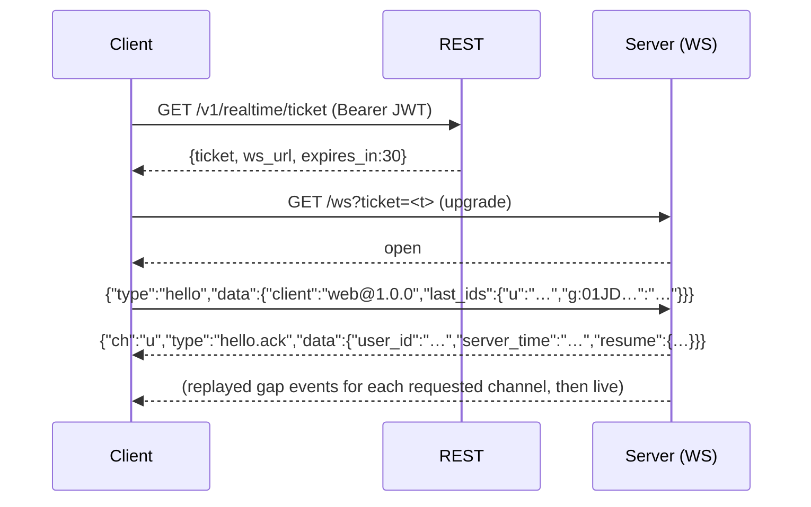

# WebSocket Protocol — Chess Hustle

**Status:** Proposed · **Endpoint:** `wss://api.<domain>/ws` · **AsyncAPI:** `contracts/asyncapi.yaml` · Related: ADR-004

---

## 1. Connection lifecycle



- Ticket: 30 s TTL, single-use (Redis `SETNX`), rotated silently client-side before expiry.
- One connection per device; N devices per user supported (u-channel fanned to all; game channel joined by every session that requests it).
- Heartbeat: protocol-level ping/pong every 15 s; server reaps dead sockets at 30 s. Client reconnects with jittered backoff (0.5s→8s) and resumes with `last_ids`.
- Client → server messages are minimal and rate-limited (20 msg/s burst 50; moves additionally ≥ 40 ms apart per game): `hello`, `resume`, `subscribe {ch}`, `unsubscribe`, `game.move`, `ping`.

## 2. Envelope (normative)

Server → client only (client→server messages are commands, never events):

```json
{ "id": "1731837164-0",        // Redis stream ID of the channel — resume cursor
  "ts": "2026-11-17T09:12:44.812Z",
  "ch": "g:01JDQ7…",           // "u:<user_id>" | "g:<game_id>" | "t:<tournament_id>"
  "type": "game.move",         // namespaced, stable, additive-only
  "data": { … } }
```

Invariants: **I-1** apply in `id` order per channel; **I-5** events are idempotent to re-receive (e.g., re-applied `game.move` with `ply ≤ known` is dropped client-side); unknown `type` ⇒ ignore (forward compatibility, ADR-009).

## 3. Channels

| Channel | Producer | Retention | Notes |
|---|---|---|---|
| `u:{user_id}` | all domains | 24 h | personal events: economy, invites, friends, notifications |
| `g:{game_id}` | hustle-chess | finish + 24 h | game events; joined via snapshot fetch or invite |
| `t:{tournament_id}` | hustle-tournaments | running + 2 h | rounds, pairings, standings |

Subscriptions: `u:` implicit on connect; `g:`/`t:` via `subscribe` (server authorizes: participant for `g:` unless game is public-shared, entrant/staff for `t:`).

## 4. Event catalog (normative names)

### 4.1 Connection
| Type | Data | Notes |
|---|---|---|
| `hello.ack` | `{user_id, server_time, config_rev}` | |
| `resume.ack` | `{per_channel: {ch, from_id, replayed}}` | replayed = count sent before live tail |
| `resume.stale` | `{ch}` | buffer exceeded → client re-snapshots (REST) then resumes live |
| `ws.error` | `{code, message, details?}` | `auth.ticket_used`, `rate_limited`, `bad_message` … |

### 4.2 Matchmaking (`u:`)
| Type | Data |
|---|---|
| `queue.entered` | `{pool, est_wait_s}` |
| `queue.left` | `{reason: "user"|"expired"|"matched"}` |
| `matchmaking.matched` | `{game_id, color, rated, tc, opponent:{handle,rating,provisional}}` → client fetches snapshot, subscribes `g:` |

### 4.3 Game (`g:`) — carries `version` (game-lifecycle I-1)
| Type | Data |
|---|---|
| `game.start` | `{fen, tc, white, black, server_ts, version:0}` (clock anchor begins) |
| `game.ready` | `{user_id, ready_count}` |
| `game.move` | `{ply, uci, san, fen, clocks:{white_ms, black_ms}, ts, version}` |
| `game.draw_offer` | `{by}` |
| `game.draw_declined` | `{by}` |
| `game.abort` | `{by, reason}` (game was aborted) |
| `game.opponent_left` | `{user_id, grace_until}` |
| `game.opponent_reconnected` | `{user_id}` |
| `game.resync` | `{snapshot_hint: true}` | server rebuilt state (post-crash) — client re-fetches snapshot |
| `game.result` | `{result, termination, ratings:{white:{before,after,delta}, black:{…}}, gold:{white_earned, black_earned}, new_public_ids? , rematch_offer?}` |
| `rematch.offered` | `{by, new_game_hint}` (on `g:` of finished game) |
| `rematch.accepted` | `{new_game_id}` |

### 4.4 Economy & rewards (`u:`)
| Type | Data |
|---|---|
| `economy.update` | `{delta, reason, balance, ledger_id}` | every Gold change incl. from other devices |
| `daily.available` | `{streak, next_amount}` | IST reset push |
| `mission.progress` | `{mission_id, progress, goal, completed}` |
| `achievement.granted` | `{achievement_id, gold}` |

### 4.5 Social (`u:`)
| Type | Data |
|---|---|
| `friend.request` | `{from:{handle,id}}` |
| `friend.accepted` | `{user}` |
| `friend.presence` | `{user_id, online}` |
| `game.invite` | `{invite_id, from, tc, rated, expires_at}` |
| `game.invite_result` | `{invite_id, accepted, game_id?}` |

### 4.6 Tournament (`t:`)
`tournament.state` `{status, round}` · `tournament.pairings` `{round, games:[{board, white, black}]}` · `tournament.standings` `{top:[…], me}` · `tournament.finished` `{final:[…], prizes}` · `tournament.game_started` `{game_id, board}`.

### 4.7 Notifications
`notification` `{kind, payload, id}` — mirrors a `notifications` row; push (FCM/APNs) is the offline companion, WS the online one.

## 5. Worked example — full rated blitz game

```jsonc
// u:01JD… matchmaking.matched
{"id":"1001-0","ch":"u:01JD…","type":"matchmaking.matched",
 "data":{"game_id":"01JDQ7…","color":"white","rated":true,
         "tc":{"initial_s":180,"increment_s":2},
         "opponent":{"handle":"vikram64","rating":1439}}}

// g:01JDQ7… (after both ready)
{"id":"1002-0","ch":"g:01JDQ7…","type":"game.start",
 "data":{"fen":"rnbqkbnr/pppppppp/8/8/8/8/PPPPPPPP/RNBQKBNR w KQkq - 0 1",
         "server_ts":"2026-11-17T09:12:30.000Z","version":0,
         "white":{"handle":"ananya_plays","rating":1424},
         "black":{"handle":"vikram64","rating":1439}}}

// White moves (client → server): {"type":"game.move","data":{"game_id":"01JDQ7…","uci":"e2e4"}}
{"id":"1002-1","ch":"g:01JDQ7…","type":"game.move",
 "data":{"ply":1,"uci":"e2e4","san":"e4",
         "fen":"rnbqkbnr/pppppppp/8/8/4P3/8/PPPP1PPP/RNBQKBNR b KQkq - 0 1",
         "clocks":{"white_ms":181934,"black_ms":180000},
         "ts":"2026-11-17T09:12:44.812Z","version":1}}

// … Black blunders; White mates on ply 34
{"id":"1002-34","ch":"g:01JDQ7…","type":"game.result",
 "data":{"result":"white","termination":"checkmate",
         "ratings":{"white":{"before":1424,"after":1440,"delta":16},
                    "black":{"before":1439,"after":1423,"delta":-16}},
         "gold":{"white_earned":25,"black_earned":5}}}
```

## 6. Resume example (metro tunnel, 40 s offline)

```jsonc
// reconnect → hello carries last_ids
{"type":"hello","data":{"last_ids":{"u:01JD…":"0995-0","g:01JDQ7…":"1002-20"}}}
// server replies resume.ack then streams the gap:
{"type":"resume.ack","data":{"per_channel":{
  "u:01JD…":{"from_id":"0995-0","replayed":2},
  "g:01JDQ7…":{"from_id":"1002-20","replayed":11}}}}
// … events 1002-21 … 1002-31 replayed, then live events continue seamlessly.
```

If the gap exceeds retention (e.g., game finished > 24 h ago): `resume.stale` → client `GET /games/{id}` for final state + PGN path.

## 7. Ordering, delivery, and abuse rules

| Rule | Value |
|---|---|
| Delivery | at-least-once per channel; dedupe by `id` client-side |
| Order | per-channel total order (Redis stream); no cross-channel ordering guarantees |
| Rate limits (client→server) | 20 msg/s burst 50; moves ≥ 40 ms apart; `subscribe` ≤ 5/s; violations → `ws.error rate_limited` then disconnect |
| Payloads | ≤ 4 KiB per client message; server events ≤ 16 KiB |
| Backpressure | server-side bounded send queues (1,024 events/socket); overflow ⇒ slow-consumer disconnect (client resumes) |
| Presence | online = ≥ 1 connected socket; friend presence events debounced 5 s |
| Authz | every publish authorizes channel membership server-side; no client-side channel forgery possible |
