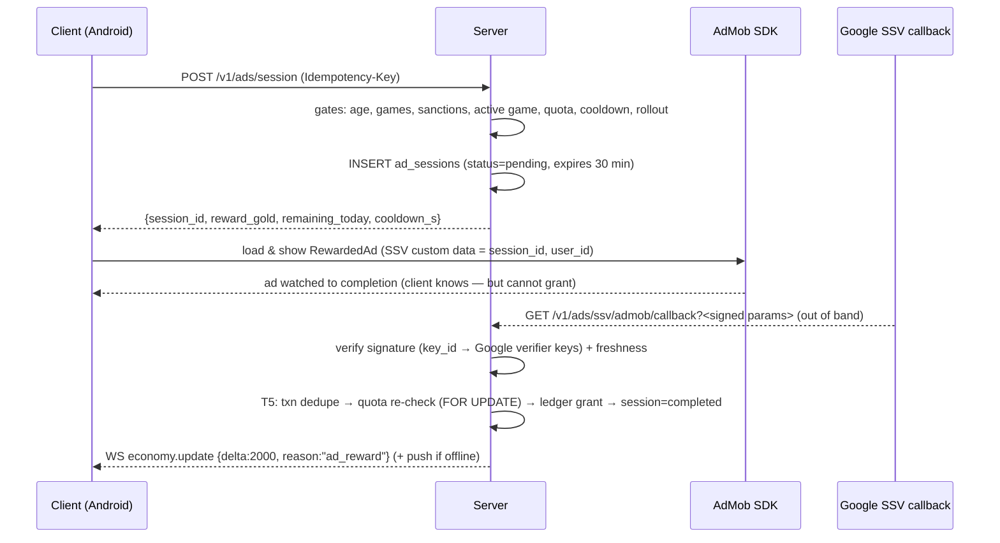

# Rewarded Ads Integration — Chess Hustle

**Status:** Proposed · **v1 provider:** Google AdMob (SSV) · **Platforms:** Android (P1/2), iOS (P3) · Web: none at v1 · Related: ADR-007

---

## 1. Product rules (normative)

| Rule | Value | Config key |
|---|---|---|
| Gold per completed ad | **2,000** (experiment A) | `ads.gold_per_ad` |
| Max per user/day | **5** | `ads.max_per_day` |
| Cooldown between ad sessions | 60 s | `ads.cooldown_s` |
| Ad session TTL | 30 min | `ads.session_ttl_min` |
| Account age ≥ | 24 h | `ads.min_account_age_h` |
| Lifetime completed games ≥ | 5 | `ads.min_games_lifetime` |
| Active game | **Forbidden** — no ad session while any of the user's games is active | — |
| Sanctions | `ad_suspension` / `suspension` users rejected | — |
| Age | 18+ only (ADR-010) | — |
| Rollout | `%` of users via feature flag `ads_experiment` | — |

UX rules: user-initiated only; the offer lives in the rewards screen and post-game screen (never mid-game); quota shown honestly ("3 of 5 today"); no forced video, no interstitials at v1.

## 2. Flow (normative)



**Idempotency key:** `ads:{provider}:{transaction_id}` on the ledger; `UNIQUE(provider, transaction_id)` on `ad_reward_events`. Google may redeliver callbacks — replays are no-ops.

**Two-entry rendezvous:** client completion and SSV callback arrive independently; the grant keys off the **callback only**. If the callback never arrives (network, misconfig), no grant — and the user can re-try after cooldown (session stays pending→expired).

## 3. SSV verification details (AdMob)

1. Callback params include `user_id`, `custom_data` (= our `session_id`), `transaction_id`, `reward_amount`, `reward_item`, `timestamp`, `key_id`, `signature`.
2. Fetch Google verifier public keys by `key_id` (endpoint cached ≤ 1 h; fetch on cache miss + on unknown key) — per Google's SSV verifier spec.
3. Verify the signature over the canonical parameter string per Google's published format; reject on any mismatch.
4. Freshness: reject `timestamp` older than 7 days (Google's guidance) — our session TTL (30 min) is the stricter gate anyway.
5. Bind: `custom_data` → `ad_sessions` row must be `pending`, unexpired, same `user_id` as callback `user_id`, same provider.
6. Quota re-check **inside T5** (`ad_quota_daily` row lock): quota can have changed between session mint and callback (other device).
7. Reward trust: `gold_amount` comes from **our config** (`ads.gold_per_ad` at grant time), never from the network's `reward_amount` — the provider's value is logged for forensics only.
8. Response: 2xx fast (single short TXN); non-retryable validation failures return 4xx (per provider spec, logged, alert if volume spikes).

## 4. Provider port (ADR-007)

```rust
trait AdVerifier {
    /// Parse + verify a raw provider callback. Returns the verified reward facts or a rejection reason.
    fn verify(&self, raw: &RawCallback) -> Result<VerifiedReward, AdReject>;
}
struct VerifiedReward { provider: Provider, transaction_id: String,
                        user_id: UserId, session_id: AdSessionId, raw_digest: [u8; 32] }
```

- `hustle-ads::admob` implements it; Unity LevelPlay / ironSource / AppLovin SSV are additive impls.
- Quota/grant/session state machine is provider-agnostic (lives in `hustle-ads::core`).
- Config: `ads.provider = "admob"`; provider-specific keys in secret store (verifier key cache only — no API secrets needed for SSV).

## 5. Client integration notes

- **Android:** AdMob SDK (play-services-ads), RewardedAd, `setServerSideVerificationOptions(customData = session_id, userId = our_user_id)`. Ad unit IDs in remote config; test units in staging. UMP/consent form shown per Google requirements for EEA-like flows; default non-personalized unless user opted in at signup (consent toggle, ADR-008/010).
- **iOS:** AdMob SDK via SPM in P3; same SSV options; **no ATT prompt at v1** (we serve non-personalized ads, so tracking permission is unnecessary — documented posture).
- **Web:** no rewarded ads (no viable rewarded provider for PWA at v1); `/ads/status` returns `enabled:false` on web user agents; UI hides the ad surface entirely. Revisit with a web-video provider post-v1.
- Anti-abuse UX: one in-flight session per user (server-enforced), spinner states derived from server events only.

## 6. Experiment plan (config-driven, no code changes)

| Variant | gold_per_ad | max_per_day | Hypothesis |
|---|---|---|---|
| A (launch) | 2,000 | 5 | Strong ad-driven retention loop |
| B (if inflation too high) | 1,000 | 5 | Halve issuance, keep loop |
| C (if engagement too low) | 2,000 | 3 + higher-value day-7 streak synergy | Quota scarcity raises per-view value |

Instrumented funnel (`app_events`): `ad_surface_shown → ad_session_created → ad_completed(client) → ad_verified(ssv) → gold_granted`. KPIs: verification ratio (verified/client-completed ≥ 95%), quota exhaustion rate, D1/D7 delta vs ads-off cohort, gold issuance share, effective eCPM vs payout, fraud-flag rate. Guardrails: pause ads globally via config in < 60 s (Redis cache TTL) if fraud spikes.

## 7. Revenue accounting (B2B side)

- Ad revenue accrues to us from the network (we never touch user money). Finance treats it as ad/export-of-service income; GST/withholding posture flagged to a CA at first payout (compliance doc §8).
- Ad revenue is **never** passed to users in any form (cash, prizes, or "revenue share" — ADR-011 boundary).
