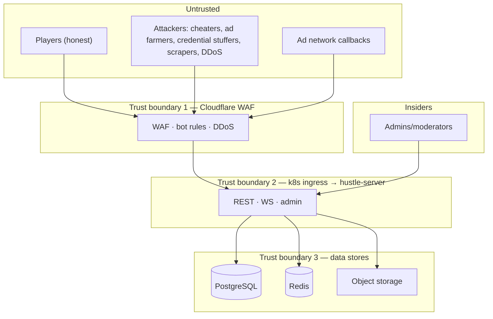

# Threat Model — Chess Hustle

**Status:** Proposed · **Method:** STRIDE per trust boundary + game/economy-specific abuse cases · Related: ADR-014 (anti-cheat), `04-economy/*`

---

## 1. Assets & trust boundaries

**Assets (ranked):** user PII & credentials → game/result integrity → Gold economy integrity → ad revenue integrity → availability → moderation/admin integrity → secrets.

## 2. Threat register (STRIDE)

| # | Threat | Boundary | Impact | Mitigations (where) |
|---|---|---|---|---|
| T-01 | **Engine assistance during play** | Players | Rating/economy trust | Deterministic server authority makes nothing forgeable; statistical detection → flags → human review (ADR-014); sanctions ladder; fairness transparency report |
| T-02 | **Client-hacked game actions** (illegal moves, fake resign/win, clock claims) | Players | Game integrity | All outcomes computed server-side; WS actions are commands only; `claim-timeout` verified against server clock truth; version+ply constraints (ADR-003, lifecycle §6) |
| T-03 | **Clock manipulation via lag-comp** | Players | Unfair time | Lag comp default OFF; if enabled: server-side caps (250 ms/move, 1.5 s/game), credit logging, anomaly flag on credit-ratio outliers (lifecycle §3) |
| T-04 | **Self-play / collusion farming** (rating + gold + missions) | Players | Economy, leaderboards | ≥ 8-ply earning guard, gameplay daily cap, pair-farming & draw-farming detectors, block-list pairing exclusions, same-pair rematch suppression (ADR-014) |
| T-05 | **Ad fraud: device farms, forged callbacks, replay** | Ad boundary | Economy + revenue | SSV signature verification (Google verifier keys), `UNIQUE(provider, txn_id)` replay wall, per-account gates (age/games), per-IP ad-session caps, ad_suspension first-line sanction (ADR-007, ads §3) |
| T-06 | **Ad-callback endpoint abuse** (unauthenticated endpoint hammered) | Edge | Availability | Separate rate-limit class (§7), signature-check-early (cheap reject), no DB writes before verification, alert on 4xx spike |
| T-07 | **OTP pumping / SMS toll fraud** | Edge | Cost + user nuisance | 3/15-min per phone, 5/hr per IP, hashed OTP storage, provider-side spend caps, alerting on send-rate anomalies (ADR-008) |
| T-08 | **Credential/session theft** (token replay, refresh reuse) | Sessions | Account takeover | 15-min access tokens, refresh rotation with family revocation on reuse, per-device sessions, session blocklist for instant sanctions, WS single-use tickets |
| T-09 | **Scraping / PGN harvesting / enumeration** | Edge | Reputational + load | Auth required on history endpoints, cursor limits, per-IP rate class, ULID public IDs (non-sequential), robots/noindex on public profiles |
| T-10 | **Multi-account evasion of bans** | Players | Sanction integrity | Device/IP correlation analytics → flags; sanctions re-applied on linkage review; no automatic hardware bans (privacy posture) |
| T-11 | **Chat abuse: spam, slurs, harassment** | Players | Safety | Rate limit (1/2 s), profanity mask incl. transliteration, quick-chat presets, report+block, moderation queue, 90-day evidence retention (MD-1) |
| T-12 | **False mass-reporting** (weaponizing moderation) | Players | Wrongful sanctions | Evidence bundles auto-attached, uphold-rate tracking per reporter, reporter-abuse flags, human review mandatory |
| T-13 | **Admin insider abuse** (gold grants,config tampering, data snooping) | People | Economy + trust | Audit log immutable & reviewed, grant caps + dual control above threshold, admin actions visible to users where user-facing, least-privilege DB roles, separate OIDC for admin UI |
| T-14 | **DoS: WS floods, move spam, queue churn, draw-offer spam** | Edge/App | Availability | WAF + per-class rate limits (§7), bounded socket queues + slow-consumer disconnect, per-game action idempotency, queue join rate limit |
| T-15 | **SSV key rotation window attack** (unknown key_id) | Ad boundary | Grant gap | Fetch-on-miss + short stale-accept window + alert; fail-closed on unverifiable callbacks |
| T-16 | **Supply chain** (dependency/backdoor) | Build | Everything | Pinned lockfiles, `cargo audit` + `cargo deny`, trivy image scan, minimal base images (distroless), signed commits, no postinstall scripts on web deps |
| T-17 | **Secrets leakage** | Build/Deploy | Everything | Secrets in SSM/Sealed Secrets, never in repo/env-committed files, rotation runbook (90-day), `gitleaks` in CI |
| T-18 | **PII over-collection / retention creep** | Data | Legal (DPDP) | Minimal PII (phone/email only), hashed IPs, retention table enforced by jobs, export/delete self-service (compliance doc §3) |
| T-19 | **Region/data-residency drift** (SaaS tools exporting data) | Data | Legal | Vendor review checklist; Sentry scrubbing; OTel attribute allowlist; documented processor list |
| T-20 | **Redis compromise** (hot state, tickets) | Data | Session/game disruption | Redis AUTH+TLS, network policies (only app pods), no user PII in Redis (ids only), rebuild-from-PG design (ADR-002) |

## 3. Game-integrity deep dive (why outcomes can't be forged)

| Attack vector | Why it fails |
|---|---|
| Client sends `game.result` | No such command exists; results are server-computed transitions only |
| Client sends moves for opponent | Sender identity = WS session user; server checks `sender == player(to_move)` |
| Replaying a winning move sequence | `(game_id, ply)` PK + version check; ply ordering enforced |
| Manipulating clocks | Only server timestamps enter the clock math; sweep flagging is server-side |
| Abusing abort to dodge losses | Abort only ≤ 4 plies, mutual-or-auto, no rating/gold effect; no rating escape hatch after 4 plies |
| Draw-offer spam as a time weapon | One outstanding offer; any move auto-declines; offer rate-limited |

## 4. Rate-limit classes (normative defaults; per-class table lives in config)

| Class | Limit | Scope |
|---|---|---|
| L-auth | 5/hr/IP (otp/send), 3/15min/phone | auth endpoints |
| L-api | 120/min/user, 240/min/IP | general REST |
| L-write | 30/min/user | mutating endpoints |
| L-move (WS) | ≥ 40 ms between accepted moves per game; 20 msg/s socket | game commands |
| L-mm | 1 queue join / 2 s; 10/hr/user | matchmaking |
| L-ads | 1 session mint / cooldown; ≤ 10 session mints/hr/IP | ads |
| L-ssv-callback | 100/min/IP; cheap signature reject first | ad callback |
| L-chat | 1 msg/2 s; 200 chars | chat |
| L-report | 5/day/user | reports |

## 5. Controls checklist (implementation gates for Phase 0/P1)

- [ ] TLS everywhere (HSTS, TLS 1.2+), Cloudflare WAF managed rules + bot fight mode
- [ ] JWT HS256 secret in SSM; kid rotation; session blocklist for instant revocation
- [ ] OTP hashed (SHA-256 + per-phone salt), single-use, TTL 5 min
- [ ] Refresh rotation + reuse detection implemented and integration-tested
- [ ] WS ticket single-use (`SETNX` + TTL), authz per channel on every publish
- [ ] Idempotency keys on safety-critical POSTs (schema-validated, 24-h window)
- [ ] DB roles: app (no DDL), migrator (DDL only), ro (SELECT); `statement_timeout` 5 s
- [ ] Redis: AUTH + TLS, network policy, no PII keys
- [ ] Ad callback: fail-closed verification, dedupe unique index, quota re-check under lock
- [ ] Admin: role middleware + audit log on every mutation; dual-control grant cap
- [ ] CI: gitleaks, cargo audit/deny, trivy, dependency pinning
- [ ] Logs: PII scrubbing (no phone/email in log lines; user_id only); OTel attribute allowlist
- [ ] Security.txt + vulnerability disclosure page (safe harbor)
