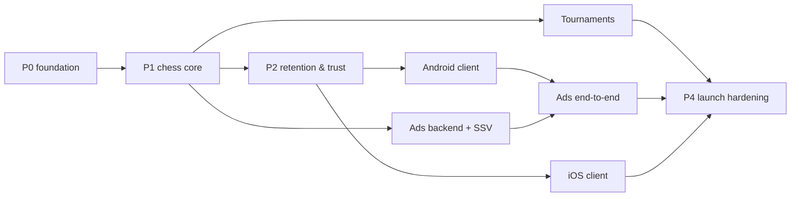

# Phased Roadmap — Chess Hustle

**Status:** Proposed · **Sized for:** 3–5 engineers (2 backend Rust, 1 web React, 1 mobile Kotlin→Swift, 1 PM/design/QA hybrid), ~3–4 months to full v1 · **Gate rule:** each phase exits only when its acceptance criteria pass (testing doc §8).

---

## Phase 0 — Foundation (weeks 1–2)

**Deliverables**
- This blueprint approved (owner sign-off on ADRs 001–014, schema, contracts).
- Monorepo scaffold (repo doc §2): Cargo workspace, web app shell, CI pipeline (lint/test/contract-gate/image), docker-compose local env.
- Schema v1 migrated in staging; OpenAPI + AsyncAPI skeletons with the contract-drift gate live.
- `hustle-server` boots with /healthz, /readyz, /meta/config; deploy pipeline to staging green.
- Counsel engagement kickoff (compliance artifacts list, ADR-011/010 review).

**Exit:** staging auto-deploys on merge; contract gate blocks drift; zero "TODO: decide later" in ADRs.

## Phase 1 — Core chess MVP on web (weeks 3–8)

**Scope:** identity (OTP + Google, consent), profiles, ratings (Glicko-2), matchmaking (rated+casual pools), full game orchestration (clocks, termination rules, resume/reconnect), game history + PGN export, daily-streak + Gold ledger + welcome grant, lobby/board UX (react-chessground), observability baseline, admin skeleton (config + audit).

**Deliverable:** two real players can play a fully rated, interrupted-and-resumed blitz game with correct ratings and Gold; history browsable.

**Exit criteria**
- E2E suite (L4 scenarios 1–6) green; 100-game bot soak zero desync; move-ack p95 ≤ 100 ms at 500 CCU staging load.
- DPDP consent flow + export/delete self-service functional.
- Reconnect across pod-kill and Redis-rebuild verified.

## Phase 2 — Retention & trust (weeks 7–12, overlapping P1 tail)

**Scope:** friends + presence + challenges, in-game chat + moderation queue + reports + sanctions, missions + achievements, cosmetics catalog + purchase + loadout, notification feed + FCM (web-later), admin console v1 (players, flags, reports, config), anti-cheat pipeline v1 (offline analyzer + anomaly queue), analytics dashboards.

**Exit criteria**
- Economy invariant suite green (overdraft/idempotency/quota).
- Moderation flows e2e (report→action→appeal path), grievance channel live.
- 2k CCU staging load green; cost dashboard live.
- Fair-play data flowing: anomaly flags visible in admin with evidence bundles.

## Phase 3 — Mobile + ads + tournaments (weeks 11–16, parallel)

**Scope (three streams):**
- **Android (Compose):** full client parity on game/social/economy; AdMob rewarded SDK + SSV against staging ad units; Play internal testing.
- **Ads (backend):** SSV verifier (AdMob), ad_sessions/quota/idempotency, experiment flags + rollout, fraud telemetry.
- **Tournaments v1 (Swiss):** creation, registration, rounds, auto-pairing, byes/forfeits, standings + Gold prize issuance (ADR-011-compliant), `t:` channel events.
- **iOS start:** SwiftUI client parallel to Android patterns; TestFlight at end of phase.

**Exit criteria**
- Ad trust suite green (forgery/replay/quota-race); verification ratio ≥ 95% in staging; experiment flag rollout tested (0→100%).
- Tournament e2e (8 players × 3 rounds incl. bye/forfeit) green.
- Android internal-track build installs + completes a rewarded ad → Gold grant visible on web (cross-platform ledger continuity).
- Store pre-review checklist (compliance §7) submitted for both stores.

## Phase 4 — Launch hardening (weeks 17–20)

**Scope:** 10k CCU load + chaos drills, security review (threat-model checklist), iOS release, Hindi copy pass + i18n audit, bot opponents experiment flag (liquidity fallback, bad-bot guard: depth-capped, labeled), season/leaderboard snapshots, fairness report v1, launch runbook (support, moderation staffing, incident comms).

**Exit:** store approvals; prod launch at staged invite cohorts; SLO dashboard green for 2 weeks.

## Phase 5 — Post-launch growth (weeks 21+)

- Regional languages (Tamil, Telugu, Bengali, Marathi, Kannada, Gujarati) — copy pipeline exists from v1.
- Spectate + follow-GM streams (read-only game channels already support it).
- Arena tournaments ( berserk-style), Chess960, daily-puzzle mode.
- Family mode design with counsel (ADR-010 revisit).
- B2B: academy/club organizer tools (tournament dashboards, certificates, rosters) — first sponsorship conversations.
- Ads: second provider port (Unity/ironSource) + web rewarded evaluation; interstitial policy decision (still never mid-game).
- Scale work per infra playbook §4 triggers.

## Dependency graph (who blocks what)

## Staffing & critical path

- **Critical path:** backend chess core (P1) → everything. Mobile starts on contract skeletons in P1 week 4 (mock transport) to de-risk.
- 2 backend engineers: one owns chess/realtime/matchmaking; the other identity/economy/ads/admin.
- Web engineer: lobby/board/economy UX P1, social P2, then support mobile QA.
- Mobile engineer: Android P2 start (UI shell) → full P3; iOS P3.
- PM/design/QA: playtests weekly from P1; compliance artifacts parallel-track; store submissions owned end-to-end.

## Explicit non-goals during v1 (enforced)

No DMs, no clubs, no spectate, no bots-as-default, no variants, no web ads, no subscriptions, no IAP, no family mode — each returns via its roadmap slot only. Paid-entry/stake mechanics return **never** without external counsel (ADR-011).
